## Basil Eldho

<picture>
  <source media="(prefers-color-scheme: dark)" srcset="assets/strata-dark.svg">
  
</picture>

I got into infrastructure by debugging things that broke at 2am. These days I'm learning KubeVirt and writing down what I find at [latencylog.tech](https://latencylog.tech).

Three years of production Go at QBurst (APIs for UNIQLO Japan and US) and Altro (YC-backed fintech). MS CS at SUNY Binghamton, finishing December 2026. On OPT from January 2027; H-1B sponsorship required.

Mostly Go and C, on Linux and Kubernetes.

[latencylog.tech](https://latencylog.tech) · [linkedin](https://linkedin.com/in/basil-eldho) · [email](mailto:basileljol@gmail.com)

 

<picture>
  <source media="(prefers-color-scheme: dark)" srcset="assets/layer-app-dark.svg">
  
</picture>

*consensus, replication, consistency, fault tolerance*

- [sleuth](https://github.com/basil-eldho/sleuth): real-time monitoring, log streaming and request tracing for Docker containers.

<picture>
  <source media="(prefers-color-scheme: dark)" srcset="assets/layer-tcp-ip-dark.svg">
  
</picture>

*transport, congestion control, protocol internals, RDMA*

- [c-server](https://github.com/basil-eldho/c-server): an HTTP server in C from raw sockets and syscalls, built up one layer at a time.

<picture>
  <source media="(prefers-color-scheme: dark)" srcset="assets/layer-kernel-dark.svg">
  
</picture>

*schedulers, virtual memory, syscalls, eBPF tracing*

- [kubevirt-lab](https://github.com/basil-eldho/kubevirt-lab): golden Ubuntu 24.04 and Windows 10 images built with Packer, run as KubeVirt VMs on a single-node kind cluster, opened in a browser. [Written up here](https://latencylog.tech/kubevirt-packer-guacamole-desktops/).
- [kubevirt-vm](https://github.com/basil-eldho/kubevirt-vm): throwaway browser-based Ubuntu desktop VMs for workshops and training.
- gowaite: eBPF uprobes on Go's runtime scheduler (`runtime.schedule`, `gcSTW`, `park`, `goready`) for live goroutine anomaly detection. Not public yet.

<picture>
  <source media="(prefers-color-scheme: dark)" srcset="assets/layer-silicon-dark.svg">
  
</picture>

*caches, pipelining, ISA design*

### Reading

- Operating Systems: Three Easy Pieces
- Computer Systems: A Programmer's Perspective (Bryant & O'Hallaron)
- Computer Networking (Kurose & Ross)
- Princeton's computer architecture lectures
